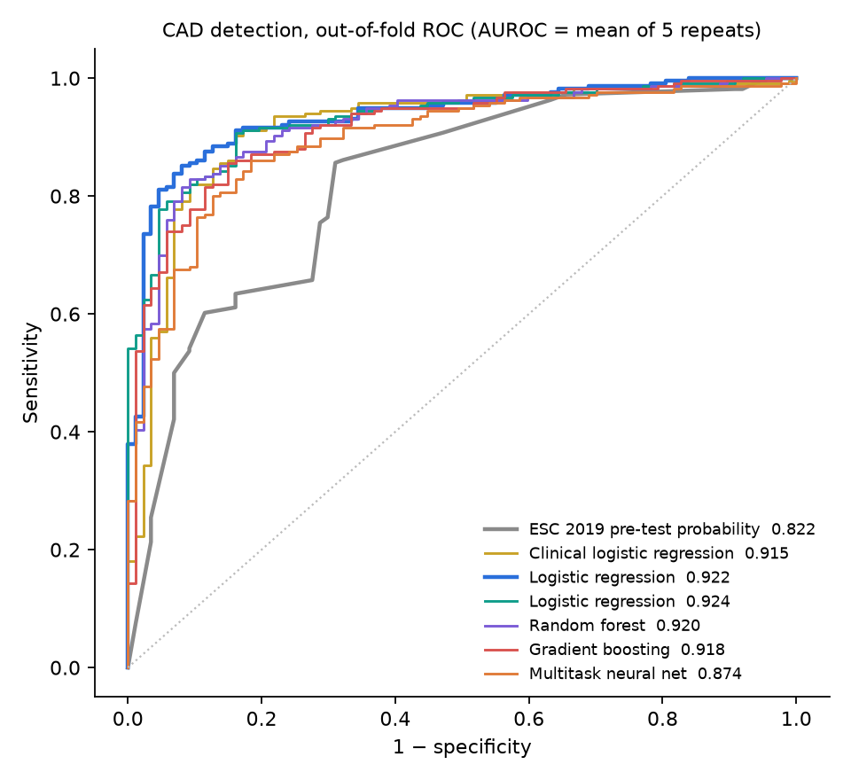
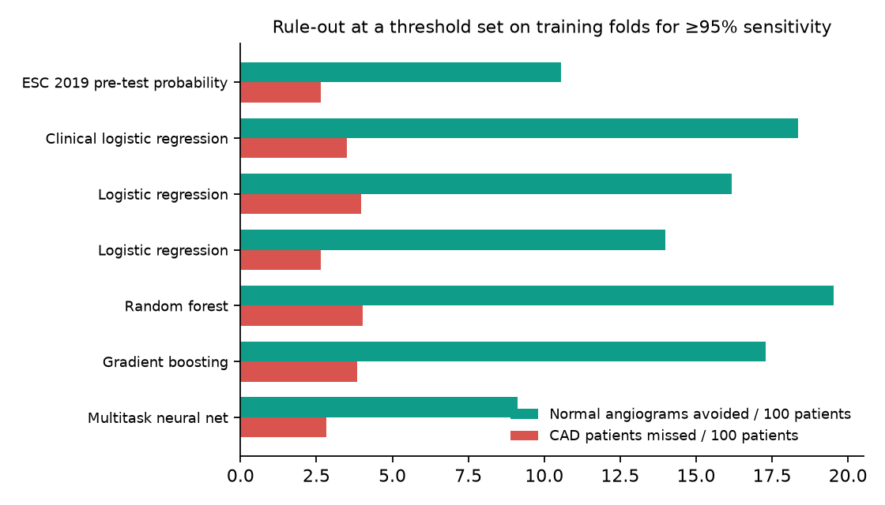

<p align="center"></p>

<h1 align="center">CardioAI</h1>
<p align="center"><b>Which cath-lab referrals will have a normal angiogram?</b><br>
Two validated, explainable pre-angiography triage models with a 3D coronary view. One is trained on 1,223 patients from 5 hospitals in 4 countries.</p>

<p align="center"><b>Live demo (no install):</b> <a href="https://aryanjaykadu.github.io/CardioAI3D/">aryanjaykadu.github.io/CardioAI3D</a></p>

> ⚠ Research prototype. Built and evaluated on 303 patients from one centre, with no external validation. **Not for clinical use.**

---

## The problem, and who has it

Invasive coronary angiography is the reference test for coronary artery disease (CAD). It needs a cath lab and arterial access, and carries a small risk of serious complications. Even among patients cardiologists already chose to refer, many angiograms are normal: **29% in this cohort**. Cath labs are a scarce resource. In many health systems the bottleneck is a cardiologist's attention to a long referral list, not the procedure itself.

**Task.** From 55 routinely collected values (history, symptoms, exam, ECG findings, blood tests, echo), estimate:

1. the probability that the angiogram will show CAD (any vessel ≥50% narrowed), and whether the patient is below a *rule-out* threshold tuned for ≥95% sensitivity;
2. the probability of stenosis in each major artery (LAD, LCX, RCA).

**Two models, for two settings.**

| | Full workup model | Bedside model |
|---|---|---|
| Inputs | 55: history, symptoms, exam, ECG findings, blood tests, echo | 7: age, sex, chest-pain type, systolic BP, fasting glucose > 120, resting-ECG ST-T change, LVH |
| Training data | 303 patients, 1 hospital (Tehran) | 1,223 patients, 5 hospitals (Tehran, Cleveland, Budapest, Zurich, Long Beach VA) |
| Validation | Internal: 5×5-fold CV | **External**: leave-one-hospital-out |
| Also predicts | LAD / LCX / RCA stenosis | CAD only |

**Users.** Cardiologists and cath-lab teams prioritising referrals. The bedside model is aimed at clinics without echo or a cardiologist. It is a second look, not a gatekeeper.

## What's in the box

| Piece | What it does |
|---|---|
| `evaluate.py` | The evaluation. It runs repeated cross-validation of 6 models plus the ESC 2019 guideline table, with bootstrap CIs, a rule-out operating point, a test-availability ablation, subgroups and a negative control. It writes `reports/eval/`. |
| `export_model.py` | Trains both deployed models on all data. It exports coefficients, 200 bootstrap coefficient sets (for uncertainty ranges), held-out predictions for every patient, and the evaluation to `dashboard/data/`. |
| `dashboard/` | A static web app (no build step). **Patient** view: pick any patient, see the out-of-fold score, the guideline estimate, the true angiography result (including misses), per-vessel risk on a 3D heart, and exact per-input contributions. Edit any input to see how the model responds. **Evidence** view: interactive trade-off curve, external validation across hospitals, and all metrics. **About** view: harms and limitations. Also included: a 90% uncertainty range for every estimate, warnings for out-of-range or missing inputs, a printable report, and **CSV batch scoring of a whole referral list, done entirely in the browser**. |
| `src/` | `features.py` (deterministic encoding), `baselines.py` (ESC 2019 table), `benchmark.py` (models + leakage-free CV), `harmonize.py` (maps 5 hospitals to one schema), `external.py` (leave-one-hospital-out validation + local-adaptation curve), `models.py` (the multitask PyTorch net from the first version of this project, kept as a comparator). |
| `tests/` | `pytest` checks for leakage, ESC-table lookups, the AUROC implementation, the threshold logic, the negative control, and that the browser model reproduces scikit-learn exactly. |

## Method

* **Data (bedside model):** the Tehran cohort plus UCI Heart Disease (#45): Cleveland Clinic (303), Hungarian Institute of Cardiology, Budapest (294), University Hospitals Zurich and Basel (123), and VA Long Beach (200). Every site uses the same label: angiographic diameter narrowing >50% in any major vessel. Only variables recorded with the same meaning at every site are kept (see `src/harmonize.py`). Missing BP and glucose are imputed with the training median plus a missingness flag.
* **Data (full model):** Z-Alizadeh Sani extension (UCI #411). 303 patients referred for angiography at a hospital in Tehran. 55 features after encoding (one constant column dropped). Labels come from angiography: CAD (71%), LAD (58%), LCX (39%), RCA (38%).
* **Encoding:** fixed, hand-written mapping (Y/N→1/0, valve-disease grade→0–3, BBB→two flags). No statistics are learned at this step, so it cannot leak. The angiography columns are never inputs.
* **Deployed model:** one standardised L2 logistic regression per target. C is chosen by inner 5-fold CV on log-loss. It was chosen because it was the best-ranked CAD model, well calibrated, and linear: the browser can run it exactly and show exact per-input contributions (coefficient × standardised value, in log-odds).
* **Comparators:** ESC 2019 pre-test-probability table (age × sex × symptom type), a clinical-only logistic regression (11 bedside variables), logistic regression with in-fold RFE to 15 features, random forest, gradient boosting, and the original multitask neural network (shared trunk + 4 heads, focal loss, Platt scaling).
* **Rule-out threshold:** chosen inside each training fold from inner 3-fold out-of-fold predictions, as the highest score that keeps sensitivity ≥95%. It is then frozen and applied to the test fold. The ESC table goes through exactly the same procedure.

## Evaluation

**Protocol.** 5 repeats × stratified 5-fold CV (seed 42). Every learned step (scaling, feature selection, C, calibration, threshold) is fit on the training fold only. Metrics are computed on pooled out-of-fold predictions and averaged over repeats. 95% CIs come from a patient-level bootstrap (B = 2000); comparisons use a *paired* bootstrap.

**Metrics.**
* AUROC: ranking.
* Brier score and ECE: calibration.
* At the rule-out point: sensitivity, specificity, NPV, and the clinical-unit metrics **normal angiograms avoided per 100 referred patients** (benefit) and **CAD patients missed per 100** (harm).

<!-- RESULTS:START -->
### Headline results (out-of-fold, 303 patients, 5×5-fold CV)

| | CardioAI (logistic regression, 55 inputs) | ESC 2019 guideline table |
|---|---|---|
| **AUROC, CAD** | **0.922** (95% CI 0.889–0.950) | 0.822 (0.767–0.873) |
| Paired ΔAUROC | **+0.100** (+0.059 to +0.145) | — |
| Brier score / ECE | 0.099 / 0.042 | 0.405 / 0.488 (mis-calibrated in this population) |
| Sensitivity at rule-out point | 94.4% (92–97) | 96.3% (94–99) |
| Specificity | 56.3% (48–66) | 36.8% (27–47) |
| NPV | 0.81 (0.71–0.89) | 0.80 (0.68–0.92) |
| **Normal angiograms avoided / 100 referred** | **16.2** (12.5–20.6) | 10.6 (7.6–14.2) |
| **CAD patients missed / 100 referred** | **4.0** (2.1–6.0) | 2.6 (1.0–4.6) |

**What this means.** Ranking patients by this model is clearly better than the guideline table: the paired bootstrap CI excludes zero. At a threshold set for ≥95% sensitivity, it would spare about 16 of every 100 referred patients a normal angiogram. The price is missing about 4 patients who do have CAD. That trade-off is the main harm, and it is why we frame this as *prioritisation support*, not a gate.

**Findings we did not expect, reported as they are.**
* **Model choice barely matters.** Logistic regression on 11 bedside variables (age, sex, symptom type, risk factors) reaches AUROC 0.915. Every model with the full inputs lands at 0.918–0.924, with overlapping CIs. The original **multitask neural network was worse** (0.874, 0.836–0.907) and is no longer the deployed model. We picked the all-feature logistic regression for calibration, exact explanations, and better LAD prediction, but after seeing CV results. That choice is mildly optimistic.
* **Vessel localisation is weak.** AUROC LAD 0.83, LCX 0.68, RCA 0.72.
* **Where it degrades.** Age ≥60: AUROC 0.855 (0.77–0.93). Patients with typical chest pain (94% have CAD): 0.838 (0.71–0.94). Men: 0.891 vs. women 0.956.
* **Test dependence.** Bedside data alone: 0.909. Adding ECG: 0.922. Labs and echo add little on top of that in this cohort.
* **Negative control.** With labels shuffled, the identical pipeline scores AUROC 0.492.
<!-- RESULTS:END -->

### External validation: bedside model in hospitals it has never seen

Each hospital is scored by a model trained only on the other four. Imputation, scaling, C and the ≥95%-sensitivity threshold all come from those four.

| Held-out hospital | n | CAD | Bedside AUROC (95% CI) | ESC 2019 | Δ AUROC (95% CI) | Sensitivity | Missed /100 |
|---|---|---|---|---|---|---|---|
| Tehran | 303 | 71% | 0.770 (0.70–0.84) | 0.831 | −0.061 (−0.13, 0.00) | **72%** | **19.8** |
| Cleveland | 303 | 46% | 0.779 (0.73–0.83) | 0.626 | +0.153 (+0.10, +0.21) | 96% | 1.7 |
| Budapest | 294 | 36% | 0.824 (0.77–0.87) | 0.504 | +0.320 (+0.25, +0.39) | 87% | 4.8 |
| Zurich | 123 | 93% | 0.753 (0.50–0.93) | 0.475 | +0.278 (+0.08, +0.48) | 97% | 3.3 |
| Long Beach | 200 | 74% | 0.676 (0.59–0.77) | 0.560 | +0.116 (0.00, +0.22) | 100% | 0.0 |
| **All, pooled** | 1,223 | 59% | **0.745** (0.72–0.77) | 0.695 | +0.050 (+0.02, +0.08) | 89% | 6.8 |

* **The transfer gap is large.** Pooled CV with hospitals mixed between training and test gives AUROC 0.841; unseen hospitals give 0.745. A new hospital should expect the lower number.
* **It beats the guideline in 4 of 5 hospitals, but fails in Tehran.** There, "no chest pain" meant low risk (10% of patients). At the four US/European sites, asymptomatic referrals had the *most* CAD, because they were referred for other reasons such as a positive stress test. The model learned the opposite rule and missed 20 of every 100 Tehran patients. A symptom can mean different things depending on referral pathway, and only external testing reveals that.
* **Calibration drifts** (slope 0.50–1.11, mean prediction off by up to 0.35). Absolute probabilities need local recalibration.
* **Local data helps where the pattern differs.** Adding 100 labelled Tehran patients to training raises Tehran AUROC from 0.770 to 0.858 (10th–90th percentile 0.84–0.87). At the other sites it barely moves. Zurich has only 8 patients without CAD, too few to estimate.

Full tables: [`reports/eval/summary.md`](reports/eval/summary.md). Raw numbers: [`reports/eval/results.json`](reports/eval/results.json). Per-patient predictions: [`reports/eval/oof_predictions.csv`](reports/eval/oof_predictions.csv).




## Reproduce

```bash
git clone https://github.com/aryanjaykadu/CardioAI3D && cd CardioAI3D
python -m venv .venv && . .venv/bin/activate      # Windows: .venv\Scripts\activate
pip install -r requirements.txt
python -m pytest -q                 # ~5 s
python evaluate.py                  # full evaluation, ~10 min on a laptop CPU (torch needed for the neural net)
python evaluate.py --quick          # 1 repeat, no neural net, ~1 min
python export_model.py              # refresh dashboard/data from the evaluation
python start_dashboard.py           # open http://localhost:8080 (no-cache headers, offline)
```

The run records its Python and library versions and its runtime in `reports/eval/results.json`. Differences you might see:
* the bootstrap CIs vary slightly with `--bootstrap`;
* the neural net's numbers can move by about ±0.01 AUROC across PyTorch versions or CPUs.

The logistic-regression and tree results are deterministic for a given scikit-learn version. The raw data can be re-downloaded with `python scripts/download_data.py` and converted with `python scripts/convert_xlsx_to_csv.py`.

## Who benefits, and who could be harmed

**Benefits**
* Patients whose angiogram would be normal could avoid an invasive test.
* Cath labs get a consistent, explainable second look when prioritising a waiting list.
* A bedside-only version (no ECG, echo or labs) still reaches AUROC 0.909, which matters for clinics without these tests.

**Harms**
* **False reassurance is the main risk.** At the ≥95% sensitivity setting, a few of every 100 referred patients have CAD yet are labelled low risk. The NPV is about 0.8, so roughly one in five "low risk" labels is wrong. The dashboard surfaces these misses deliberately (see the featured case "MISSED").
* **Transport risk, now measured.** The bedside model missed 20 of every 100 CAD patients in the one hospital whose referral pattern differed (Tehran). The full model has never been tested outside its own hospital, so its real-world miss rate is unknown and probably higher.
* **Over-trust in visuals.** The 3D heart is schematic. Vessel-level predictions are much weaker than CAD-level ones, and the UI says so beside them.

## Limitations: when the result stops being useful

* **Full model: internal validation only.** 303 patients from one centre, so the CIs are wide. The bedside experiment shows external performance can fall by about 0.1 AUROC or more.
* **Bedside model: old data, heterogeneous sites.** The UCI cohorts were collected in the 1980s. Site case-mix differs wildly (36–93% CAD), and calibration does not transfer. Before any use, recalibrate on local patients and check sensitivity.
* **Referral population.** CAD prevalence is 71%. The model is **not** for screening, primary care or emergency chest pain, where prevalence is far lower and the NPV would change.
* **Label definition.** "≥50% stenosis" is anatomical. It does not capture functional significance (FFR) or acute coronary syndrome.
* **Input availability.** The deployed model expects all 55 inputs. Wall-motion abnormality has a large weight, yet dropping echo and labs costs little here (AUROC 0.922 → 0.922 with ECG only, 0.909 bedside only). That may not hold in other cohorts. Missing inputs are not handled; a user must supply a value.
* **ESC table mis-calibration.** The table was derived in lower-prevalence populations. We compare it on ranking and with the same threshold procedure, but its absolute probabilities are not meaningful here.
* **What-if edits are associational.** They show how the model's score responds, not what would happen to the patient.
* **Vessel localisation is weak.** LCX and RCA AUROCs are only moderate.

## What we would do with another month

1. Site-adaptive modelling: let the chest-pain effect vary by referral pathway, and add a recalibration step that needs about 50 local cases.
2. A modern external cohort for the full model, with ECG, labs and echo.
2. Decision-curve analysis plus a cost model (angiography cost vs. expected cost of a missed lesion).
3. A "silent-mode" prospective log at a partner cath lab.
4. Usability testing with cardiologists, and a plain-language patient view.

## Attribution

* **Dataset:** *Extension of Z-Alizadeh Sani dataset*, UCI Machine Learning Repository (ID 411), Alizadehsani R. et al. Licensed CC BY 4.0.
* **Dataset:** *Heart Disease*, UCI Machine Learning Repository (ID 45), Janosi A., Steinbrunn W., Pfisterer M., Detrano R. (1988). Licensed CC BY 4.0. Principal investigators: Hungarian Institute of Cardiology, Budapest (A. Janosi); University Hospitals Zurich and Basel (W. Steinbrunn, M. Pfisterer); VA Medical Center Long Beach and Cleveland Clinic Foundation (R. Detrano). Re-download with `python scripts/download_uci_heart.py`.
* **Guideline baseline:** Knuuti J. et al. *2019 ESC Guidelines for the diagnosis and management of chronic coronary syndromes.* Eur Heart J 2020;41:407–477, Table 5 (pre-test probabilities from Juarez-Orozco L.E. et al., 2019).
* **Libraries:** [three.js](https://threejs.org) (MIT; `dashboard/lib/three.*.js` and `OrbitControls.js` are unmodified copies), scikit-learn, PyTorch, NumPy, pandas, SciPy, matplotlib, pytest.
* **Liquid Glass effect** (`dashboard/liquid-glass.js`): a framework-free port of the SVG-displacement technique from [liquid-glass-react](https://github.com/rdev/liquid-glass-react) by rdev (MIT) and [shuding/liquid-glass](https://github.com/shuding/liquid-glass). The filter chain is the same: backdrop blur, then `feDisplacementMap`, three per-channel passes for chromatic aberration, and a screen blend. The displacement map is our own pixel-space rounded-rectangle SDF. Found via [awesome-liquid-glass](https://github.com/carolhsiaoo/awesome-liquid-glass) (CC0). Refraction renders only in Chromium browsers; Safari and Firefox, and users who prefer reduced transparency, get a plain blur.
* **Code:** written by the author. The procedural 3D heart (signed-distance-field anatomy, `dashboard/heart.js`), ECG renderer and dashboard are original. The rounded-cone and ellipsoid distance functions follow Inigo Quilez's published formulas. AI coding assistants were used during development.

## License

Code is released under the [MIT License](LICENSE). The datasets keep their original CC BY 4.0 licences, and three.js is MIT (details in [NOTICE](NOTICE)). This is research software, not a medical device.
